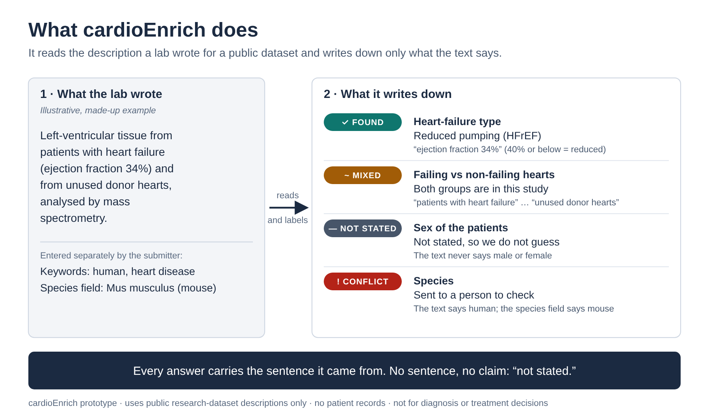
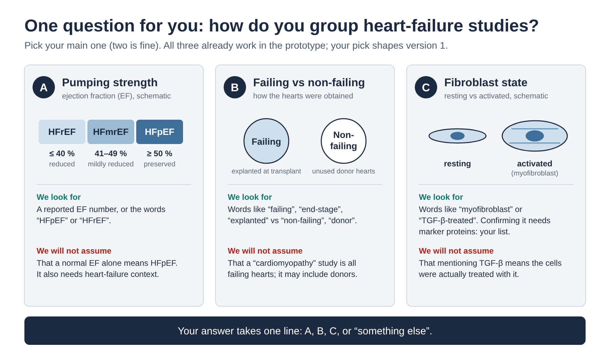

## About cardioEnrich

**cardioEnrich is an open-source, evidence-aware metadata extraction framework for cardiovascular proteomics research.**

Public proteomics repositories contain valuable studies of heart failure, cardiac remodeling, and cardiovascular disease. However, essential details—such as heart-failure subtype, ejection fraction, donor status, biological sex, tissue region, and experimental model—are often buried in free-text descriptions.

This makes it difficult to identify suitable datasets, compare studies, and reuse published molecular evidence confidently.

**cardioEnrich addresses this problem by turning unstructured dataset descriptions into structured, traceable research metadata.**

Rather than guessing what a study must contain, the framework distinguishes:

- **Reported or definitionally derived:** Supported by explicit source evidence and, where applicable, a documented rule.
- **Mixed:** Multiple biological groups or categories are reported.
- **Conflicting:** Available metadata contain potentially incompatible statements that require review.
- **Unknown or abstained:** The available evidence does not support a specific claim.

Each extracted assertion retains its supporting text and rule provenance, allowing researchers to inspect why a label was assigned.

### Why this matters

Consider a researcher searching for proteomics datasets comparing failing and non-failing human hearts, or studying HFpEF and HFrEF. Finding records that mention *heart failure* is only the beginning. The researcher must also determine whether the samples, phenotype labels, and experimental context actually support that comparison.

cardioEnrich is being developed to make those decisions more transparent, auditable, and reproducible.

### Current status

The public repository contains a **deterministic cardiovascular extraction prototype**, documented rule changes, example ProteomeXchange records, automated tests, and a benchmark harness. It builds on the architecture of [pxEnrich](https://github.com/kalyanidhusia/pxenrich_AIagent).

The broader research roadmap includes independent expert validation, archive-wide metadata audits, molecular corroboration, a searchable evidence index, and community-standard metadata contributions. These are development aims, not completed capabilities of the current public demo.

**Scope:** Research-dataset metadata only. cardioEnrich is not a clinical diagnostic tool and does not provide patient-level medical decisions.

## cardioEnrich — cardiovascular evidence agent (domain-layer demo)

The cardiovascular counterpart of [pxEnrich](https://github.com/kalyanidhusia/pxenrich_AIagent):
same deterministic-extraction architecture, assertion states, provenance, and
CI-gated benchmark — with the breast-cancer domain layer swapped for a
cardiovascular one (`rule:cardio-v0.1`).

**The deliverable in this repo is the domain diff, running:**
`docs/RULES_DIFF.md` (cardio vocabulary + extraction-rule diff vs pxEnrich
`rule:v0.1` — the Approach skeleton) + a working extraction demo over 10 real
cardiac ProteomeXchange records and 2 labeled synthetic ones.

Non-diagnostic research-metadata tool. No PII anywhere. The LLM layer is not
included in this demo at all — everything here is deterministic.

## Visual overview

### From research descriptions to traceable evidence



*Figure 1. Illustrative synthetic example of evidence extraction. Labels retain their supporting source text; uncertain or discordant metadata are flagged rather than silently resolved.*

### Biological dimensions of cardiovascular studies



*Figure 2. Three complementary metadata dimensions: EF-defined heart-failure phenotype, failing versus non-failing tissue, and experimentally reported fibroblast state. They are not interchangeable and can coexist within a study.*

## Quick start (offline, ~5 s, stdlib-only engine)

```bash
conda env create -f environment.yml && conda activate cardioenrich   # or any Python ≥3.10

python demo.py                      # evidence cards → out/evidence_report.md + out/assertions.jsonl
python tests/run_benchmark.py       # 32 curated expectations; exits non-zero on ANY false assertion
python tests/test_cardioenrich.py   # 17 unit tests on derivation rules D1–D5
jupyter notebook cardioenrich_demo.ipynb   # the walk-through
```

## What the demo shows

| Assertion state | Live example in the seed |
|---|---|
| asserted (derived) | CARDIO-DEMO-0001: stated LVEF 32 % → **HFrEF** (rule D1, Universal-Definition bands) |
| asserted (term) | PXD060431: title states **HFpEF** → heart failure propagated (D3, definitional) |
| mixed | PXD018678: **ICM + DCM** comparative cohort; PXD057195: human + mouse |
| conflicting | **PXD047728 (real)**: species field *Mus musculus*, keyword *"human"* (D5); CARDIO-DEMO-0002: "preserved EF" beside "LVEF 34 %" (D4) |
| abstained | PXD017765: cardiac tissue stated, **no disease named** — a cardiac study is not a disease study |
| unknown | `sex_context` on 10/10 real records — the SABV metadata gap, quantified |

And the rule that is deliberately **absent**: "cardiomyopathy study ⟹ failing
cohort" is banned (D2) — PXD018678 contains donor controls, so that propagation
would be a false assertion. Only definitional propagations (TNBC→ER− style,
here HFpEF→HF) are allowed.

## Layout

```
cardioenrich/            models.py (cardio EVIDENCE_FIELDS; dataclasses unchanged from pxEnrich)
                         extraction.py (rule:cardio-v0.1 — lexicons + rules D1–D5)
data/seed/               cardio_seed_datasets.json (10 real records fetched 2026-10-30 + 2 synthetic, flagged)
tests/                   run_benchmark.py (same harness/metrics as pxEnrich; CI gate)
                         benchmark/cardio_benchmark_schema.json + example_records.jsonl (32 expectations)
                         test_cardioenrich.py (D1–D5 unit tests)
docs/RULES_DIFF.md       ← the main deliverable
demo.py                  runner; cardioenrich_demo.ipynb — notebook walk-through
out/                     generated: evidence_report.md, assertions.jsonl
```

## Known limits of this demo (named, not hidden)

- Seed records carry **title/keywords/species/instrument only** — descriptions
  (where EFs, doses, donor counts, and sex usually live) require the pxEnrich
  live-ingest path (`pridepy` / PROXI) from a network-enabled machine; records
  upsert by accession.
- The corpus-scoping count ("N PRIDE datasets match the cardio vocabulary") is
  the known ~1-hour live task, not done here.
- No FTS5 index / Flask API / MCP server yet — those layers port unchanged from
  pxEnrich once the domain layer is agreed; this repo is the domain layer.
- v0.2 decisions awaiting Dr. Bagchi: primary subtype axis, fibroblast-activation
  marker list, cardio-oncology priority (docs/RULES_DIFF.md §7).
